# Chat Critters — Nib

Nib is an original pixel-art character that lives and evolves alongside your Twitch chat. Beyond running to, eating and jumping over comments, Nib replies to chat topics and carries the results of questions and polls into its next reaction. It sits transparently in a corner of your OBS scene.



[Architecture diagrams and explanation](docs/ARCHITECTURE.md) · [Docker and storage diagram](docs/diagrams/deployment.svg)

## Where judges and reviewers should start

1. [Submission overview](docs/SUBMISSION.md): goals and technical highlights.
2. [Architecture](docs/ARCHITECTURE.md): the path from Twitch → emotion and conversation → OBS.
3. [Doc index and code reading order](docs/README.md): module owners, demo, validation records and Codex development history.

## Key features

- **One Nib, six forms**: each minute of chat is judged by AI as one batch. With 5+ accepted comments from 1+ viewer, Nib evolves into Calm / Laugh / Hype / Angry / Confused; minutes with fewer than 5 return it to the base form. Body shape, accessories and motion all change, with a ~3.2-second transformation sequence.
- **Instant reactions**: Nib chases comments to eat them, hops over them, falls asleep and more. Five emotions × four intents give 20 distinct reactions.
- **Two-way conversation**: context-aware replies, a speaking style per form, emotes synced with speech, and follow-ups to viewer answers. Questions and custom polls tally real answers.
- **Short-term memory and familiarity**: 10 minutes of conversation memory by default, plus familiarity Lv0-3 keyed to an anonymous stable ID. Supports OFF, deletion and opt-out.
- **Stream-ready display**: Nib, speech bubbles, answer windows, the five emotions and 12 minutes of message volume render on one shared Canvas. The dashboard and OBS use the same renderer.
- **Visual context and review**: optional screenshot/chat jokes every ten minutes, image context for selected screen questions, and six-hour local response history.
- **Cost control**: everyday behavior runs locally. The minute emotion AI and conversation AI share a budget, an hourly limit and a concurrency limit, and the emotion AI is never called for minutes with fewer than 5 messages.

## Getting started

Requires Node.js 22+ and npm.

```powershell
npm ci
if (-not (Test-Path .env)) { Copy-Item .env.example .env }
npm start
```

- Dashboard: <http://127.0.0.1:3000/>
- OBS Browser Source: <http://127.0.0.1:3000/?overlay=1> (e.g. 1280×720)
- [Compare the six forms and motions](http://127.0.0.1:3000/nib-lab/) / [Replay an evolution](http://127.0.0.1:3000/nib-lab/evolve.html)

By default the server listens on localhost only. Add the URL to OBS as a Browser Source. Everything around Nib is transparent, so Chrome tabs and bookmark bars never show up. Use `?overlay=1&preview=1` only when you want a checkerboard preview.

A freshly copied `.env.example` has **demo ON and paid AI OFF**. Keep your existing `.env` and saved settings.

Docker is supported too. If the Windows build is already using the same port, stop it first, then run `docker compose up --build --detach --wait`. A Docker-only volume is the default. See [Startup, CI and Docker](docs/guides/OPERATIONS.md) for carrying over an existing ledger and settings, and for CI details.

## Demo without any API

Start with `DEMO_MODE=true`. Even with keys configured, the app makes no Twitch connection, creates no OpenAI client and sends no paid requests. No external images, CDNs or audio are needed.

1. Click "Pause demo chat" to stop the automatic sample messages.
2. Use "Chat Pulse demo" to see all five emotion evolutions. Normally Nib is judged every minute; the demo replays simulated history so you can compare them quickly.
3. In "Talk with Nib", click "Talk to Nib" → wait for the reply → click "Reply". Nib's next line uses the actual answer.
4. Click "Ask about topic" to collect scores, or "Poll about topic" and switch between Viewer A/B to vote, then show the results announcement.

Demo conversation uses **context-bound local sample replies**, not generation by a real model. Activity Spike is an example of message volume, not a sixth emotion. [Demo script](docs/guides/DEMO_SCRIPT.md)

## Connect to Twitch automatically

Set your channel in `.env` and run `npm start`. Both channel URLs and plain channel names work.

```dotenv
DEMO_MODE=false
TWITCH_CHANNEL=https://www.twitch.tv/your_channel
OPENAI_API_ENABLED=false
```

Once connected, the top of the screen shows `Live · #your_channel`. Public chat is read through an anonymous, receive-only IRC WebSocket that reconnects after disconnects. The app never posts to chat.

The connection is monitored with a WebSocket Ping every 20 seconds and the matching Pong. A connection with no reply for 10 seconds is dropped and reconnected after 5 seconds. Joining the channel also has a 15-second deadline, and late events from old connections are ignored. Hover the connection indicator in the top right to see received, accepted and filtered counts plus the last response time. `twitch` in `/api/state` also carries diagnostics with no message text or user IDs.

`!jump` makes Nib jump, `GG 💖` cheers, `LOL 😂` laughs, and `!sleep` sleeps. `!battle` requires broadcaster or moderator authorization from the tags Twitch sends. Only comments that pass the spam, duplicate and unsafe-word filters are accepted.

By default, evolution needs 5+ accepted comments from 1+ viewer within 60 seconds. Posts such as "GG" that keyword rules can't classify are still sent to the generative AI as a batch and judged from context. The bars show AI emotion scores, not measured shares of people. Fewer than 5 messages returns Nib to the base form. With 5+ messages but AI OFF, budget reached or a failure, the reason is shown and the last judged form is kept. Poll results never force a form change.

## Using generative AI

Uses the server-side `OPENAI_API_KEY` and model settings; turn features on from the dashboard after connecting live. The **minute emotion AI** and **live AI replies** have independent switches. In a new setup, connecting to Twitch alone never enables paid AI.

- The emotion AI runs on a fixed 60-second cycle and sends one batch only when that minute has 5+ messages. The payload is safety-checked and capped at 100 messages / 8,000 characters, with no user IDs. Late results are never applied to the next, not-yet-judged window.
- The reply AI picks candidates: 18-second minimum interval by default, 30-second candidate lifetime, 7-second timeout. One reply in flight at a time, no retries. It never sends every comment to the AI.
- Responses are validated with a strict JSON Schema via `text.format` plus Zod. Stale responses, invalid evidence and unsafe output are discarded.
- Default daily budget $0.10, shared hourly limit of 20 calls. This does not guarantee 60 emotion checks per hour; AI checks stop once the limit is reached. Cost is reserved before each call, and the reservation stays when usage is unknown. Prices are estimates from configured values.
- For operator testing, `OPENAI_MAX_CALLS_PER_HOUR=0` disables the hourly call cap across sentiment, replies and visual jokes. The daily budget, intervals and concurrency guard still apply. Restart after changing it; the default remains 20.
- `OPENAI_DAILY_BUDGET_ENABLED=false` disables daily budget enforcement for testing. For an existing saved data directory, also turn on **No daily budget limit** in AI Settings and save; persisted settings take precedence. The stored dollar amount, usage ledger and concurrency remain intact. New/default installations keep the budget enabled.
- Settings and usage persist in `data/ai-state.json`. Saved ON/OFF, budget and interval take precedence over `.env` defaults. To stop normally, switch it OFF in the dashboard.

The budget is an estimate based on this app's configured prices and does not replace billing limits on your OpenAI project. [Conversation, cost and privacy details](docs/design/NIB_CONVERSATION.md)

## Layout and build

```text
src/
  server/             # Twitch, conversation AI, state and cost management, entry point
  client/             # Dashboard and OBS, Canvas, Nib rendering and previews
  shared/             # Shared definitions for emotion classification, evolution forms and actions
tests/
  unit/               # Unit, HTTP and mocked SDK transport tests
  browser/            # Browser tests for conversation, evolution, visibility and more
docs/
  SUBMISSION.md       # Overview for judges
  ARCHITECTURE.md     # Overall design
  CODEX_SESSIONS.md   # Codex development log
  design/             # Detailed spec per feature
  guides/             # Demo script and startup / CI / Docker steps
  validation/         # Live stream validation results
scripts/              # Checks, build and container validation
.github/workflows/    # CI
```

The root holds the README and the standard entry points for npm, Docker and environment settings. `data/` is local storage, `dist/` is build output, `artifacts/` holds validation records and `node_modules/` holds dependencies; none of them are part of the submitted source.

| Location | Contents |
|---|---|
| `src/server/` | Twitch intake, emotion and evolution, conversation, polls, memory and familiarity, AI and cost management |
| `src/client/` | Dashboard, shared Canvas, code-drawn Nib, current previews |
| `src/shared/` | Shared definitions for emotion classification, evolution forms and actions |
| `tests/` | Regression tests split into `unit/` and `browser/` |
| `scripts/` | Syntax checks, current asset build, container validation |
| `.github/workflows/` | Windows/Linux checks, browser tests and Docker validation |
| `Dockerfile` / `compose*.yaml` | Secret-free production image and startup config with persistent data |
| `docs/` | Specs, architecture, demo and submission material, real Codex session records |

```powershell
npm test
npm run check
npm run build
npm run start:prod
```

Use `npm run verify` to run checks, unit tests and the build in one go.

`start:prod` serves `dist/public`. It shares `.env`, `data/` and the lock with the development server, so two servers never run at once. The build clears old output before generating the current Nib files.

Run browser tests after a production build. They use Edge/Chrome on Windows or Playwright's Chromium, with a mock server and local traffic only. No paid APIs are called. On CI/Linux, run `npx playwright install --with-deps chromium` and then `npm run test:ci-browser` to test visual questions/history, stream jokes, minute sentiment, conversation, evolution and visibility together.

```powershell
npm run test:visual-browser
npm run test:stream-jokes-browser
npm run test:minute-browser
npm run test:evolution-browser
npm run test:conversation-browser
npm run test:visibility
```

Additional tests for current features: `test:pulse-browser`, `test:personality-browser`, `test:browser`, `test:evolution-sequence`. Images and traces can be regenerated into the Git-ignored `artifacts/`.

The current 184 unit/HTTP tests, syntax/type checks and build passed on Windows and Docker Linux. All six current browser suites passed on Windows; an earlier three-suite revision also passed on Linux. Real-service examples include Twitch intake, jumping, continued conversation, two-account questions/polls, minute evolution and a screenshot-based joke. On-demand visual-question accuracy against a live stream remains unverified. See the [live stream record](docs/validation/LIVE_VALIDATION.md) and [operations guide](docs/guides/OPERATIONS.md) for evidence, failures and limits.

## Not included in the submission

`.env`, `data/`, `node_modules/`, `dist/` and `artifacts/` are Git-ignored. Never publish keys, familiarity data or the cost ledger. Retired character studies, temporary migration helpers and old diagnostic outputs have been removed. Current Nib previews and tests remain available. Nib's artwork is original and drawn in code.

Do not delete your local `data/`; you would lose the usage ledger and saved settings. To reset only the display counters, use the reset button in the dashboard.

- [Submission overview](docs/SUBMISSION.md)
- [Startup, CI and Docker](docs/guides/OPERATIONS.md)
- [Architecture](docs/ARCHITECTURE.md)
- [Emotions and the six forms](docs/design/NIB_EMOTION_EVOLUTION.md) / [Evolution sequence](docs/design/EVOLUTION_SEQUENCE.md)
- [Chat Pulse](docs/design/CHAT_PULSE.md) / [Motion per emotion](docs/design/PERSONALITY.md)
- [Codex Session ID log](docs/CODEX_SESSIONS.md)

## Optional ten-minute stream jokes

Nib can combine a delayed Twitch stream screenshot and a bounded sample of the last ten minutes of chat in one multimodal request, then show a joke and matching emote in both views. Register a Confidential Twitch app, set server-only `TWITCH_CLIENT_ID` and `TWITCH_CLIENT_SECRET`, and enable the feature in conversation settings. The image may be up to five minutes old. It shares the configured AI limits (defaults: 20/hour and $0.10/day); explicit testing overrides are described above. [Setup, data flow and privacy](docs/design/STREAM_JOKES.md).

## Visual questions and response review

Screen-dependent questions can use a server-fetched Twitch preview with the existing credentials. It can be several minutes behind live; offline/fetch failures fall back to chat-only answers. Sanitized comments and Nib replies are retained locally for up to six hours in `data/conversation-log.json` (secondary bound: 5,000 entries), including across reconnect/restart. The dashboard keeps its latest-20 view and links to the full `/api/conversation/logs` history. AI memory remains short and separate, and viewer privacy deletion clears the shared archive. [Behavior, data and verification](docs/design/VISUAL_QUESTIONS_AND_HISTORY.md).
