# Architecture

Implementation lives in `src/server`, browser code in `src/client`, and environment-independent emotion/form/action definitions in `src/shared`. Tests are grouped under `tests/unit` and `tests/browser`. The shared source is served at `/shared` during unbundled development and included by the production bundles; server code and saved data are never static assets. [Reviewer guide](README.md) maps each pipeline to its entry points.

## Runtime

Node.js 22 / Express serves the dashboard and transparent OBS overlay. Twitch arrives through a read-only IRC WebSocket. Accepted interactions and snapshots reach the browser over same-origin SSE. Preview and OBS both use `mountStage`; the browser never receives API keys or runs an AI SDK.

The Twitch connection verifies a matching WebSocket Pong every 20 seconds, with a 10-second response deadline. An unresponsive socket is invalidated immediately, marks AI disconnected and retries after 5 seconds. Channel join acknowledgement has a 15-second deadline. Socket identity guards discard delayed data/close/error events from prior connections. `/api/state.twitch` exposes phase, timestamps and receive/accept/drop counters without retaining message bodies or user identifiers. This prevents a half-open, long-lived connection from remaining labelled connected indefinitely. See the [ws heartbeat guidance](https://github.com/websockets/ws#how-to-detect-and-close-broken-connections).

[Open full-size runtime diagram](diagrams/runtime.svg) · [Editable Mermaid source](diagrams/runtime.mmd)

The shared AI-policy box represents in-process checks in the providers, `Store` and `ai-lease.js`; it is not an additional service. Local reactions do not wait for AI. Minute sentiment requires 5+ accepted messages from at least one viewer; a lower-activity minute restores Base Nib without a request. Ten-minute jokes enter the existing conversation queue, while selected viewer questions can request a preview on demand. Thumbnails are delayed stills, not live video. The labelled offline demo replaces external providers with local examples.

## Independent pipelines

1. **Immediate interaction:** each accepted comment generates local movement without awaiting AI. The single actor has a bounded priority/aging queue. Consumption and cleanup occur once even after a hidden-tab time gap.
2. **Minute emotion/evolution:** `ChatPulse` closes a 60-second window. In live mode, `MinuteSentiment` sends a bounded safe-text batch when at least five accepted messages from one viewer exist. Structured AI scores determine bars and the highest-scoring form without keyword/dominance vetoes. Fewer than five accepted messages reset `NibEvolution` to base without an API call. Local rules remain for the labelled offline demo.
3. **Event-driven conversation:** `Conversation` selects relevant candidates, prioritizes direct replies and answers, and bounds memory, queues and lifetimes. The live provider returns validated text, animation, evidence IDs and an optional follow-up. A labelled local provider implements the same flow for zero-API demos.
4. **Ten-minute visual jokes:** `StreamJokes` keeps a separate bounded comment window; `TwitchFrame` obtains a server-only app token and a bounded thumbnail. One multimodal request combines the still with sampled chat, then uses the existing conversation queue and speech renderer. The still may be up to five minutes old. Offline streams, errors and shared limits skip the job. See [stream jokes](design/STREAM_JOKES.md).
Live sentiment uses a fixed minute cadence, independent of event-driven replies. It does not also run the former 180-second atmosphere-advice provider. Late, cancelled or window-mismatched results cannot overwrite a later reset. Budget/hourly limits and provider failures are displayed rather than replaced by hidden local inference; a later low-activity minute still returns to base.

All AI paths share `Store`'s cost ledger, daily budget, hourly cap and `ai-lease.js` concurrency guard. They reserve estimated worst-case cost before sending, use no retries and retain reservations when usage is unknown. Demo mode blocks real providers and Twitch connections.

## Character and animation

`mascot-sprites.js` supplies the original base sprite and gestures. `nib-evolution-sprites.js` composes six distinct 64×56 indexed forms. `nib-forms.js` maps emotions to forms. All runtime artwork is original code-native pixel art; retired humanoid/robot sprite sheets are no longer included.

`action-variants.js` chooses the five moods × four intents; `action-motion.js` and `StageDirector` handle poses and safe boundaries. `EvolutionSequence` runs anticipation, charge, silhouette morph, reveal and landing in about 3.2 seconds. Speech and its emote begin on the same frame. Transformation takes priority; stale old-form speech is discarded and new-form speech waits for the safe boundary.

Evolution and short speech emotes pause the action clock so queued comments are not consumed invisibly. CPU color spans are repainted every frame. A scratch canvas commits complete frames; failures preserve the previous frame and retry. Context/visibility restoration and integer device pixels prevent the previously reported blank-character failure.

The compact widget is normally 320×380 CSS pixels, expanding to 470px high while a question/poll card is active. Outside pixels are transparent in OBS. Charts have a small translucent backing. Current Nib form and transformation preview pages use the same rendering modules.

## Conversation, polls and privacy

Short memory contains actual viewer/Nib utterances, event results and form changes, with evidence IDs. Initial retention is 10 minutes, up to 120 entries, with at most 3500 text characters supplied as history. Disconnect/stop clears transient history. Selected screen-dependent replies and visual jokes can receive a delayed Twitch still; neither may claim live video, motion or audio. All chat and visible image text are untrusted, and no AI operation can mutate settings, votes, evolution or scores.

Questions use choice, rating or open answers. Unique stable viewers contribute their first answer/vote only; results, averages and ties are calculated by the server. Insufficient participation produces a local skip response. Results influence speech and emotes, not forced form selection.

Explicit manual question/poll requests may reuse a previous question text; automatic events and ordinary conversation still suppress duplicate speech. This allows an operator to run a poll on the same topic as a completed question without silently losing the requested event. Existing event, cooldown, input/output safety and budget checks still apply.

Proactive question/poll requests use operation-specific strict output schemas: followup is required, choice questions have two or three options, and rating/open questions have no options. Candidate and evidence IDs are constrained to application-supplied enum values and checked again after generation. The spoken question is the same text as the collection card. Nested question variants use `anyOf` for Structured Outputs compatibility.

Relationships store salted, channel-specific HMAC identities, points, cooldowns and retention metadata. Relationship profiles contain no raw Twitch IDs, display names or utterances. Separately, the operator-requested review log retains sanitized source comments and Nib replies locally for up to six hours (5,000-entry safety bound), surviving disconnect/restart and clearing on viewer privacy deletion. Levels are 0–3; repeated spam does not continuously earn points. Local controls and `!nib forget / optout / optin` support deletion and opt-out. See [conversation specification](design/NIB_CONVERSATION.md).

## Storage and controls

[Open full-size deployment diagram](diagrams/deployment.svg) · [Editable Mermaid source](diagrams/deployment.mmd)

The deployment view shows the default Compose installation. `compose.host-data.yaml` replaces the named volume with the existing host `data/` folder. Native `npm start` runs the same server directly on loopback without the container boundary. HTTP control arrows represent local settings/requests; the app never posts viewer messages to Twitch.

- `.env`: server-only credentials and startup mode/channel. HTTPS Twitch URLs normalize to channel logins.
- `data/ai-state.json`: atomic settings, usage and cost reservations.
- `data/relationships.json`: minimal relationship profiles and opt-out hashes.
- `data/conversation-log.json`: six-hour sanitized response review history; no image bytes or viewer identifiers.
- `data/server.lock`: one server per data directory.

Native startup accepts only loopback sockets with a localhost Host header for `/api`. Explicit container mode binds inside Docker and accepts bridge sockets; Compose publishes exclusively on host `127.0.0.1`. Localhost Host and same-origin/JSON write controls remain active, and forwarded headers are not trusted. CSP limits browser resources to local assets. Error messages are fixed codes; raw provider errors and secrets are not logged. Filters are small rule sets and do not guarantee comprehensive multilingual moderation.

The startup lock includes PID, hostname and local/container namespace. Another runtime's PID is never treated as evidence of a stale lock, including legacy numeric locks encountered from Docker. Graceful shutdown releases the lock; ambiguous foreign locks fail closed. Default Compose uses a named volume; `compose.host-data.yaml` explicitly opts into existing native data.

`GET /healthz` returns only process liveness, without settings or identities. Twitch's phase/Pong counters and conversation errors remain separate operational signals.

## Build and verification

`scripts/build.mjs` checks the resolved output stays inside this project, removes stale `dist/public`, bundles the app and current preview modules, and copies an explicit list of current preview assets. It does not ship former character studies, scripts, credentials or data.

GitHub Actions defines Windows/Linux verification and a container smoke job, without credentials. The image uses a digest-pinned Node.js 22 base and separate build/production dependency stages. Only production dependencies, server modules, necessary shared data modules and built assets reach the non-root runtime. An allowlist build context excludes credentials, saved data and local artifacts. See [operations](guides/OPERATIONS.md).

The current 184 unit/HTTP tests and production checks/build passed on Windows and Docker Linux. The six browser suites cover visual questions/history, stream jokes, minute sentiment, conversation, evolution and visibility. [GitHub Actions run for revision d837e5a](https://github.com/Tetsuya-Uchimura/twitch-chatpets/actions/runs/41163888806) passed all three jobs: Windows verification, Linux verification and container smoke. Both hosted verification jobs ran all six browser suites. Container liveness, recreation persistence, active-ledger exclusion, image contents and origin/Host controls also passed locally; see the [operations guide](guides/OPERATIONS.md). Separate live checks on 2026-10-30–31 confirmed actual Twitch reception, a viewer-triggered jump, contextual model replies, questions/polls with two real accounts, and AI responses grounded in the calculated tie results. The operator confirmed a reply bubble in OBS; live event-card rendering was checked in the OBS overlay browser. These are bounded live examples rather than a broad quality or latency benchmark; see [live validation](validation/LIVE_VALIDATION.md).
